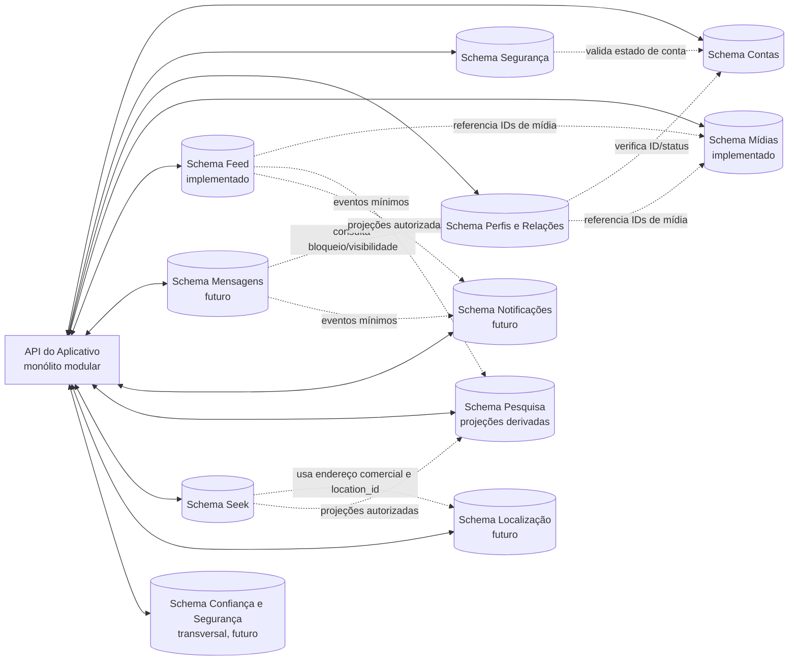

# Domínios de dados do Seekalive

**Status:** arquitetura vigente: separação lógica por domínio em um único PostgreSQL compartilhado no desenvolvimento. Não há exigência atual de bancos físicos, instâncias, provedores ou credenciais separados.
**Atualizada:** 30/10/2026.
**Ambiente:** desenvolvimento. Em 30/10/2026, a inspeção confirmou as trilhas de Contas, Segurança, Profiles, Feed e Mídias e 20 tabelas nos cinco schemas ativos: `accounts` (4), `security` (4), `profiles` (5), `feed` (6) e `media` (1). Não há tabela ativa em `seek` neste modelo. Nenhum dado de conta foi consultado.

## Objetivo e limites

Este documento define a propriedade lógica dos dados por domínio. Cada domínio tem seu schema PostgreSQL e sua responsabilidade no código, mas os schemas podem compartilhar a mesma instância e conexão durante o desenvolvimento. O Aplicativo continua um monólito modular; não há requisito atual para separar aplicativos, serviços ou bancos físicos.

O inventário do acoplamento atual e a sequência idempotente proposta para Contas e Segurança estão detalhados em [Fronteiras e fluxos entre Contas e Segurança](accounts-security-workflows.md).

A arquitetura de referência do anexo contém dez domínios de produto: Contas, Segurança, Perfis/Relações, Mídias, Feed/Publicações, Mensagens, Notificações, Pesquisa, Seek e Localização. Confiança e Segurança de Conteúdo é uma responsabilidade transversal adicional, separada pelos motivos descritos abaixo. **Shop está fora do escopo atual**; não serão criadas tabelas, APIs ou operações do Shop nesta etapa.

O modelo Drizzle atual declara 20 tabelas em cinco schemas ativos: Contas (4), Segurança (4), Profiles/Relações (5), Feed (6) e Mídias (1). O banco de desenvolvimento foi conferido após a aplicação das trilhas de Feed e Mídias. Mensagens, Notificações, Pesquisa, Localização e Confiança e Segurança ainda não têm tabelas implementadas. As migrations têm trilhas e ledgers independentes por domínio, embora usem a mesma instância PostgreSQL no desenvolvimento. `docs/api/backend/schema-core.sql` continua uma proposta histórica, não uma migration executável.

## Regras de arquitetura propostas

1. **Uma identidade:** cada pessoa ou comércio tem uma única conta Social, com `account_id` UUID global, imutável e criado em Contas. A conta comercial que aparece no Seek continua sendo essa mesma identidade.
2. **Um domínio é dono da fonte oficial:** outro módulo acessa os dados pelo contrato/serviço do domínio dono; não passa a gravar ou manter uma cópia da fonte oficial.
3. **IDs estáveis:** UUID é a referência entre domínios; e-mail e username nunca são chaves de relacionamento. Como os domínios compartilham o PostgreSQL nesta arquitetura, FKs e transações locais entre schemas podem ser usadas quando protegem uma invariável existente. Ownership e acessos no código continuam delimitados por módulo.
4. **Separação por responsabilidade:** senha/sessão não ficam em Contas; perfil público/comercial não vira uma extensão genérica de Contas; índices de busca e notificações não passam a ser fontes oficiais.
5. **Privacidade preservada:** idade permanece privada em Contas e nunca entra em DTO público; coordenada atual do usuário não é persistida por padrão. Endereço residencial de prestador não pode ser exposto como endereço comercial sem autorização explícita.
6. **Efeitos assíncronos explícitos:** uma operação síncrona no banco compartilhado pode usar transação local; efeitos externos ou assíncronos exigem ordem, idempotência e tratamento de falhas parciais.
7. **Ambientes:** o projeto está em desenvolvimento. A arquitetura não escolhe hospedagem final nem exige que o aplicativo seja hospedado na Replit. A escolha de provedor e qualquer banco físico externo ficam fora do escopo atual.

## Escopo de infraestrutura

Esta organização define schemas e ownership lógico; não provisiona bancos, não seleciona provedor e não configura conexão externa. A implantação final ocorrerá fora do Replit, conforme decisão do usuário. A stack de hospedagem e a topologia física serão tratadas no planejamento de implantação, não como requisito para continuar a modelagem lógica.

## Matriz de domínio e propriedade

| Domínio (schema lógico)                                                    | Fonte oficial e dados que possui                                                                                                                                                      | Não deve possuir                                                                                                                                  |
| -------------------------------------------------------------------------- | ------------------------------------------------------------------------------------------------------------------------------------------------------------------------------------- | ------------------------------------------------------------------------------------------------------------------------------------------------- |
| **Contas** (`accounts`)                                                    | UUID, username normalizado, e-mail e verificação, tipo/status, idade/termos privados, cadastro e interesses privados. A idade só é usada no servidor para a regra 18+.                | Senhas, sessões e tokens.                                                                                                                         |
| **Segurança** (`security`)                                                 | Hashes Argon2id; sessões e revogações; desafios de verificação/recuperação; tentativas e eventos mínimos de segurança. Referencia a conta por UUID.                                   | Username como chave, conteúdo de perfil, posts ou mensagens.                                                                                      |
| **Perfis/Relações** (`profiles`)                                           | Propriedade-alvo dos perfis pessoais e comerciais, além de relações de seguimento, pedidos privados, bloqueios, visibilidade e salvos tipados. Círculo é derivado de dois follows efetivos, sem tabela própria. No código atual, nomes/bio pessoais e nome/bio comercial ainda estão em `accounts.accounts`; a extração não está concluída. | Senhas, tokens, e-mail privado ou uma segunda identidade para o comércio.                                                                         |
| **Mídias** (`media`)                                                       | Metadados e ciclo de vida de fotos/vídeos; galeria derivada por conta e referências ao armazenamento. Na etapa atual, os binários ficam em armazenamento local somente no desenvolvimento. | Binários grandes no PostgreSQL ou autorização baseada apenas em URL/blob do cliente.                                                              |
| **Feed/Publicações** (`feed`)                                              | Publicações, artigos, comentários/respostas, curtidas, reposts, hashtags, menções e referências de conteúdo. `posts.media` contém IDs tipados de ativos pertencentes a Mídias.      | Credenciais, arquivos binários ou fonte oficial de perfil/comércio/mídia.                                                                         |
| **Mensagens** (`messages`)                                                 | Conversas, participantes, mensagens, solicitações, estado de envio/leitura e preferências próprias de mensagens.                                                                      | Senhas, cópia da tabela de bloqueios, corpos de mensagens em logs ou alegação de criptografia ponta a ponta não projetada.                        |
| **Notificações** (`notifications`)                                         | Caixa de notificações, preferências de entrega, inscrições push e estado de entrega/leitura; eventos de origem são referências mínimas.                                               | Credenciais, tokens de sessão ou cópias integrais de mensagens.                                                                                   |
| **Pesquisa/Indexação** (`search`)                                          | Documentos de índice derivados, versões/checkpoints e reconstrução; pode usar PostgreSQL até haver evidência para outra tecnologia.                                                   | Fonte oficial de perfil, post, comércio ou produto; segredos, idade, e-mail ou localização precisa.                                               |
| **Seek** (`seek`)                                                          | Descoberta por localização e categorias, consumindo uma projeção dos perfis comerciais públicos originados em Social/Profiles.                                                        | Cadastro/identidade comercial, edição do perfil comercial ou criação/resposta de avaliações. Não é fonte canônica dos perfis.                    |
| **Localização** (`location`)                                               | Catálogo geográfico oficial (incluindo municípios IBGE) e geometria PostGIS para busca geográfica, quando implementados.                                                              | Posição atual persistida por padrão ou endereço inferido.                                                                                         |
| **Confiança e Segurança de Conteúdo** (`trust_safety`, transversal)        | Casos de denúncia, evidências mínimas, decisões de moderação, ações aplicadas e eventual recurso; acesso restrito. Os alvos continuam pertencendo ao domínio de origem.               | Credenciais/sessões, fonte original do conteúdo, cópias integrais desnecessárias ou execução direta de mutações em outros domínios.                 |

### Diagrama conceitual

O desenho representa domínios lógicos, não bancos físicos nem serviços implantados.

### Dados operacionais transversais

- **Auditoria:** eventos de autenticação pertencem a Segurança; mudanças de conteúdo pertencem ao domínio que as executou. Um log central, se necessário, deve receber eventos mínimos e não virar cópia dos dados.
- **Exclusão/retificação/portabilidade:** Contas pode manter o pedido e o estado de coordenação; cada domínio continua responsável por excluir ou anonimizar seus próprios dados e confirmar conclusão. Backup não é apagado seletivamente por esta proposta.
- **Outbox e idempotência:** se um fluxo justificar entrega assíncrona, a outbox transacional fica no banco que grava a mudança; chaves de idempotência ficam junto à operação que as usa. Não criar uma outbox central por conveniência.
- **Webhooks:** recibos/deduplicação pertencem ao domínio que recebe e processa o webhook. Não há integração de pagamentos definida.
- **Categorias:** Seek mantém a taxonomia de negócios/eventos. Localização é dona do catálogo de municípios. Shop não tem taxonomia ativa enquanto estiver fora do escopo.
- **Salvos/coleções:** a recomendação é Perfis/Relações guardar a relação privada `(account_id, resource_type, resource_id)`. A leitura deve consultar o domínio de origem e reautorizar o recurso; item removido/privado não pode vazar metadados. Alternativa: cada domínio guardar seus próprios salvos, se o produto preferir.
- **Confiança e Segurança:** a revisão confirmou que denúncias e decisões sobre contas, publicações, mensagens e estabelecimentos não são fonte oficial de nenhum domínio existente. Mantém-se como schema lógico separado por restringir acesso a evidências e decisões e por atuar sobre alvos de vários domínios. Nenhuma tabela ou regra de moderação está implementada; categorias, evidência mínima, papéis, retenção, apelação e comandos enviados ao domínio dono precisam ser aprovados antes da implementação. Não registrar conteúdo integral como cópia por padrão.
- **Shop:** fora do escopo atual. A migration histórica `0004` criou um schema vazio `shop`; ela não será reescrita nem executada novamente para remover esse vestígio. O código atual deixa de tratar Shop como domínio ativo; qualquer limpeza física futura exige inspeção e migration própria.

## Mapeamento das tabelas atuais

O mapeamento abaixo representa a propriedade no modelo de código. A unidade comercial e as relações estão em `profiles`; a tabela `seek.business_profiles` legada não consta entre as tabelas ativas confirmadas no banco de desenvolvimento.

| Tabela atual                    | Schema lógico proprietário no modelo atual                                | Situação e próxima separação                                                                                                                                                                                                                                                                          |
| ------------------------------- | ------------------------------------------------------------------------- | ----------------------------------------------------------------------------------------------------------------------------------------------------------------------------------------------------------------------------------------------------------------------------------------------------- |
| `accounts`                      | `accounts`                                                                | Identidade, username, tipo/status, idade/termos privados e onboarding. A tabela ainda mantém alguns campos de perfil e preferências legados; não são duplicados. A separação desses campos será feita junto às APIs de Perfil e Mensagens, com migração compatível. `is_verified` não é selo público. |
| `account_emails`                | `accounts`                                                                | E-mail e confirmação privados; API valida o desafio de Segurança antes de atualizar.                                                                                                                                                                                                                  |
| `account_username_reservations` | `accounts`                                                                | Reserva temporária do @ liberado, com prazo de expiração.                                                                                                                                                                                                                                             |
| `password_credentials`          | `security`                                                                | Hash Argon2id e versão da política; nenhuma senha em claro ou cópia em Contas.                                                                                                                                                                                                                        |
| `auth_challenges`               | `security`                                                                | Desafios de uso único, finalidade, tentativas, expiração e consumo.                                                                                                                                                                                                                                   |
| `sessions`                      | `security`                                                                | Sessões/CSRF revogáveis; referencia `accounts.accounts.id` no PostgreSQL compartilhado.                                                                                                                                                                                                               |
| `business_profiles`             | `profiles`                                                                | Extensão comercial da mesma conta Social: categoria, modalidade de descoberta e endereço principal. O nome e a bio ainda vêm de `accounts.accounts`. Seek consome uma projeção; não é fonte de perfil. A migration Profiles `0001` transfere a tabela legada de `seek` sem substituir nem apagar seus registros. |
| `account_interests`             | `accounts`                                                                | Respostas originais privadas. Algoritmos recebem somente projeção autorizada e necessária; consentimento, edição e exclusão devem ser respeitados.                                                                                                                                                    |
| `account_follows`               | `profiles`                                                                | Relação aceita entre UUIDs; Círculo é derivado da mutualidade.                                                                                                                                                                                                                                        |
| `account_follow_requests`       | `profiles`                                                                | Pedido pendente não concede visibilidade; aprovação cria follow efetivo.                                                                                                                                                                                                                              |
| `account_blocks`                | `profiles`                                                                | Bloquear remove follows/pedidos nas duas direções. Mensagens futuras continuam aplicando a política; histórico deve ser ocultado enquanto o bloqueio existe e restaurado ao desbloquear.                                                                                                              |
| `media.assets`                   | `media`                                                                   | Metadados e ciclo de vida do ativo. O binário local é acessado por chave gerada pelo servidor; a API valida sessão, assinatura, tamanho e visibilidade antes de servir. |
| `feed.posts.media`               | `feed`                                                                     | Lista ordenada de IDs de ativos tipados; o Feed grava o post e anexa os ativos em uma transação após confirmar titularidade e estado temporário. |

### Separação por campo do `accounts` atual

| Campo atual                                                      | Schema que o mantém hoje | Separação planejada                                                                                                                                                              |
| ---------------------------------------------------------------- | ------------------------ | -------------------------------------------------------------------------------------------------------------------------------------------------------------------------------- |
| `id`                                                             | `accounts`               | UUID global estável; nunca e-mail/username.                                                                                                                                      |
| `username`, `accountType`, `status`                              | `accounts`               | Unicidade e ciclo de vida ficam centralizados. Nome público e @ seguem as regras já aprovadas.                                                                                   |
| `age`, termos aceitos                                            | `accounts`               | Privados; idade não é devolvida nem mesmo em Configurações.                                                                                                                      |
| `firstName`, `lastName`                                          | `accounts`               | Dados privados de cadastro; não enviados na projeção pública pessoal.                                                                                                            |
| `firstName`, `lastName`, `displayName`, `bio`                    | `accounts` por enquanto  | Dados públicos/de perfil ainda não foram extraídos para Profiles. A migração precisa preservar os valores, manter os contratos e coordenar as trilhas Profiles e Accounts antes de remover as colunas antigas. |
| `locationLabel`, `websiteUrl`, `isPrivate`                       | `accounts` por enquanto  | Campos legados de perfil/preferência; não foram movidos nesta etapa. Privacidade deve permanecer coerente com as regras de visibilidade enquanto sua propriedade é consolidada. |
| `messagesPolicy`, `readReceipts`                                 | `accounts` por enquanto  | Serão movidos a `messages` quando a API de Mensagens assumir essas preferências.                                                                                                 |
| `onboardingCompletedAt`, `account_interests`                     | `accounts`               | Estado e respostas privadas; personalização não altera a política de privacidade do perfil.                                                                                      |
| `isVerified`                                                     | `accounts`, uso interno  | Não oferecer selo público. A confirmação de e-mail serve ao controle de acesso; não retornar `isVerified` em DTOs públicos.                                                      |
| `version`, timestamps                                            | `accounts` hoje          | Ao separar campos, cada domínio terá controle de concorrência próprio, sem versão global gravada por vários domínios.                                                            |

## Entidades propostas em `schema-core.sql`

O arquivo propõe um modelo de 43 tabelas em um único SQL, inclusive entidades antigas de Shop. Esse arquivo é referência histórica, não migration aplicável; Shop continua excluído. Caso outra entidade seja retomada, deve ser transferida para o schema lógico do domínio proprietário e revisada contra o modelo atual. As migrations são mantidas em trilhas por domínio:

- **Contas:** `accounts`, `account_emails`, `account_interests`, `account_username_reservations`.
- **Segurança:** `password_credentials`, `auth_challenges`, `sessions`, `trusted_devices`.
- **Profiles/Relações:** perfis pessoais e comerciais, campos públicos a extrair de `accounts`, privacidade, `follows`, `blocks`, `mutes` e, conforme decisão de produto, `saved_resources`.
- **Mídias:** `media.assets`; binários locais apenas no desenvolvimento. Avatar, capa, galeria, feed e Seek devem referenciar IDs de mídia, sem expor caminho físico.
- **Feed:** `posts` (com IDs tipados em `posts.media` no modelo atual), `post_mentions`, `hashtags`, `post_hashtags`, `comments`, `comment_likes`, `post_likes`, `reposts`, `post_references`.
- **Seek:** consultas/projeções de descoberta por localização e categorias, sempre alimentadas por perfis comerciais canônicos de Social/Profiles. Seek não é a tela nem o fluxo de criação/gestão de avaliações. Avaliações aparecem no perfil comercial; o domínio persistente proprietário das avaliações deve ser definido antes de implementar suas operações, e não deve ser assumido como Seek. Horários, serviços, comodidades e endereço pertencem à apresentação/dados do perfil comercial conforme o contrato de Profiles. Não incluir `business_service_areas`: o usuário decidiu que o perfil mostra somente o endereço principal, sem área geográfica de atendimento.
- **Shop:** fora do escopo atual; `shop_items` não é tabela aprovada para implementação nesta fase.
- **Mensagens:** `conversations`, `conversation_participants`, `messages`.
- **Notificações:** `notifications`, `push_subscriptions`.
- **Localização:** `cities` e novas tabelas geográficas com PostGIS; a proposta SQL atual não contém PostGIS nem coordenadas.
- **Pesquisa:** documentos e checkpoints derivados precisam de um schema futuro; a proposta não contém índice/search tables.
- **Confiança e Segurança:** `reports` e `moderation_actions` pertencem ao schema lógico `trust_safety`; alvos são referências tipadas a recursos de outros domínios. Não há tabelas ativas ainda.
- **Operacional ainda a detalhar:** `audit_logs` ficam com o domínio que registra o fato (autenticação em Segurança); `privacy_requests` são coordenados por Contas e executados nos domínios donos; `outbox_events` e `idempotency_keys` ficam localmente com a transação que os exige; `webhook_receipts` pertencem ao domínio integrador. `account_settings` precisa ser dividido por responsabilidade. Não há um banco genérico para esses elementos.

## Fluxos entre domínios: fonte de verdade e consistência

| Fluxo                         | Donos e ordem proposta                                                                                                                                                                                 | Falha que precisa ser tratada                                                                                                                                                                                                                      |
| ----------------------------- | ------------------------------------------------------------------------------------------------------------------------------------------------------------------------------------------------------ | -------------------------------------------------------------------------------------------------------------------------------------------------------------------------------------------------------------------------------------------------- |
| Cadastro/verificação          | Adaptadores de Contas e Segurança gravam seus dados em schemas próprios dentro do PostgreSQL compartilhado; Auth coordena e a sessão só é emitida após verificação.                                           | A transação compartilhada mantém atomicidade nesta fase. Falhas externas de entrega de e-mail continuam com os próprios estados/retries do desafio. |
| Login                         | Segurança compara Argon2id e gerencia limites; valida em Contas o estado ativo e o e-mail verificado; só então cria sessão.                                                                            | Falha de leitura ou estado desconhecido falha fechado: não criar sessão.                                                                                                                                                                           |
| Perfil comercial e descoberta | Profiles mantém o perfil comercial canônico da conta Social; Seek recebe uma projeção para busca e descoberta, sem ser consultado como origem dos dados do perfil.                                        | Nenhuma identidade/estabelecimento duplicado. Atualizações e remoções na projeção devem ser propagadas de forma idempotente.                                                                                                                      |
| Publicação com mídia/local    | Mídias recebe o arquivo em fluxo, valida assinatura/tamanho e cria ativo temporário do titular. Feed valida propriedade e prazo, grava o post e anexa os IDs na mesma transação. O arquivo local só é habilitado em desenvolvimento. | Falha na gravação do post remove uploads temporários; exclusão do post remove seus arquivos. Armazenamento de produção, processamento de mídia e reconciliação de arquivos órfãos ainda não estão implementados. |
| Bloqueio e mensagens          | Perfis/Relações grava bloqueio e remove relações afetadas; Mensagens consulta a regra antes de enviar/ler e oculta histórico enquanto ativo.                                                           | Histórico não é apagado; após desbloqueio fica restaurável, conforme regra atual. Cache/índice não pode continuar exibindo conteúdo bloqueado.                                                                                                     |
| Notificação e indexação       | O domínio de origem é dono do fato; Notificações/Search recebem evento ou projeção mínima e reautorizam antes de exibir.                                                                               | Duplicatas e eventos fora de ordem são esperados; definir idempotência, remoção e reconstrução antes de adicionar worker.                                                                                                                          |
| Exclusão/retificação de conta | Contas coordena; Segurança revoga sessões; no fim da retenção, Mídias remove os arquivos locais antes da exclusão da conta e das cascatas do banco.                                                               | Falha ao remover qualquer arquivo interrompe a exclusão e permite nova tentativa. Em produção, a remoção depende do provedor de armazenamento que ainda será escolhido. |

## Decisões que ainda precisam do usuário

1. **Política de Confiança e Segurança:** as responsabilidades justificam um domínio lógico separado, pois moderação cruza várias fontes e precisa restringir evidências/decisões. Antes de construir a função, definir autorização dos moderadores, tipos de evidência, retenção, apelação e protocolo de solicitação de ação ao domínio dono.
2. **Redes e marcas:** uma conta tem no máximo uma unidade física principal. Ainda não foi decidido se várias contas comerciais independentes podem ser vinculadas a uma marca/rede; não criar entidade-pai nem compartilhamento de seguidores, avaliações ou dados até haver essa regra.
3. **Salvos/coleções:** confirmar se Perfis/Relações pode ser fonte de salvos globais tipados, ou se cada módulo deve guardar seu próprio favorito.

## Ordem e critérios para adoção

- A ordem de produto continua: concluir e validar Social antes de avançar para Seek. Shop não participa desta sequência.
- O desenvolvimento usa uma única infraestrutura PostgreSQL com schemas lógicos; a topologia física futura não é requisito nem bloqueio deste trabalho.
- Cada domínio mantém schema, modelagem, trilha de migration e ledger próprios. Como a instância é compartilhada, transações podem cruzar schemas quando necessário e justificado. Acessos no código devem seguir os contratos e módulos proprietários.
- Testar cada domínio quanto a constraints, autorização, operações concorrentes, idempotência e integridade. PostGIS só será adicionado quando Localização for implementada, com testes de SRID, validação, índice espacial e plano de consulta.

**Conclusão:** a arquitetura ativa é um aplicativo modular com domínios e schemas lógicos separados dentro de uma infraestrutura PostgreSQL compartilhada no desenvolvimento. Shop não entra nesta etapa. Confiança e Segurança permanece como domínio lógico transversal, ainda sem tabelas ou API. O inventário físico citado é histórico e não foi atualizado nesta atividade; não houve conexão, migration ou alteração de banco. Cada conta comercial mantém no máximo um endereço principal e o Seek não inclui áreas de atendimento.

**Registro histórico Feed — 28/10/2026:** o schema Drizzle `feed.posts` e a migration `0005_mushy_centennial.sql` estavam no código e no journal local. A consulta read-only daquele dia confirmou que a tabela não estava fisicamente presente. Esse dado não foi reconferido nesta atividade.

**Validação de organização lógica — 30/10/2026:** os schemas ativos do código foram separados em arquivos por domínio e o registro runtime do Drizzle foi tornado explícito. `drizzle-kit check` e typecheck de bibliotecas passaram. Nenhum banco foi conectado, consultado ou alterado; nenhuma migration foi aplicada ou gerada.
