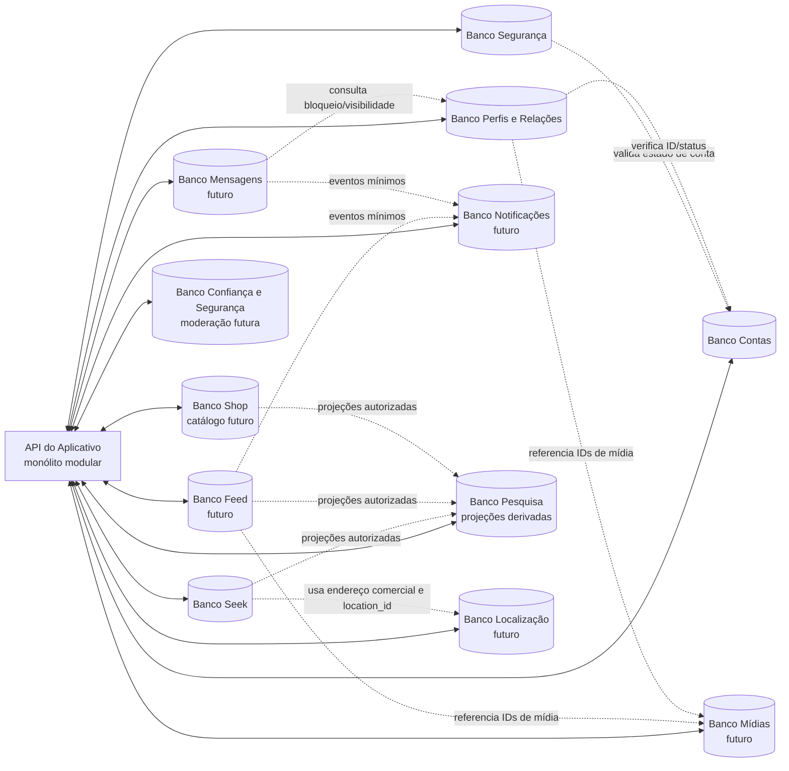

# Domínios de dados do Seekalive

**Status:** decisão-alvo atualizada em 29/10/2026: cada domínio terá seu próprio banco de dados físico. O banco de desenvolvimento observado ainda é compartilhado e, portanto, não representa a arquitetura-alvo.
**Atualizada:** 29/10/2026.
**Ambiente observado:** desenvolvimento. A reconferência do banco permanente usou somente metadados: a instância contém os 12 schemas lógicos de domínio e `public`; quatro (`accounts`, `security`, `profiles` e `seek`) têm 12 tabelas físicas. `feed` existe, mas está vazio; o código Drizzle e a migration `0005` declaram `feed.posts`, ausente no banco. Os outros sete schemas de domínio não relacionados a Feed também estão sem tabelas. `public` não contém tabelas base. A migration `0005` foi validada em namespace temporário; depois da limpeza, não havia schemas temporários e o fingerprint das colunas, constraints, índices e views consultados permaneceu idêntico. Nenhuma linha de usuário foi consultada; produção não foi consultada nem alterada.

## Objetivo e limites

Este documento define a propriedade dos dados por domínio. A regra aprovada é um banco de dados físico independente para cada domínio; um schema dentro de um banco compartilhado não satisfaz essa regra. O Aplicativo continua um monólito modular: isso não exige separar os aplicativos ou implantar um serviço por domínio. A independência dos bancos exige contratos entre domínios e impede FKs ou transações SQL compartilhadas entre eles.

A arquitetura reconhece doze domínios: Contas, Segurança, Perfis/Relações, Mídias, Feed, Mensagens, Notificações, Pesquisa, Seek, Localização, Shop e Confiança e Segurança de Conteúdo. Shop começa pelo catálogo; Confiança e Segurança começa por denúncias e ações de moderação. Os schemas atuais são apenas a organização transitória dentro da instância compartilhada; não equivalem aos bancos físicos independentes da arquitetura-alvo. Tabelas e operações serão acrescentadas quando a respectiva fatia do backend for implementada. Isso não inclui automaticamente pedidos, pagamentos, estoque ou logs gerais.

O schema Drizzle é a fonte de verdade do modelo atualmente codificado: declara 13 tabelas em cinco schemas. A consulta de 29/10/2026 confirmou 12 schemas de domínio no banco de desenvolvimento compartilhado; `accounts`, `security`, `profiles` e `seek` contêm 12 tabelas físicas, enquanto `feed` está vazio apesar de `feed.posts` existir no modelo e na migration `0005`. Os sete outros schemas estão vazios e reservados para etapas futuras. Esse modelo e as migrations ainda não estão separados por bancos físicos de domínio. O journal local contém seis migrations, mas não foi encontrada tabela de histórico com nome contendo `drizzle` ou `migration`; `drizzle-kit check` valida os arquivos locais, não sua aplicação física. A migration `0005` passou em schema temporário e a remoção foi verificada. `docs/api/backend/schema-core.sql` continua uma proposta e não pode ser executada como está.

## Regras de arquitetura propostas

1. **Uma identidade:** cada pessoa ou comércio tem uma única conta Social, com `account_id` UUID global, imutável e criado em Contas. A conta comercial que aparece no Seek continua sendo essa mesma identidade.
2. **Um domínio é dono da fonte oficial:** outro módulo acessa os dados pelo contrato/serviço do domínio dono; não passa a gravar ou manter uma cópia da fonte oficial.
3. **IDs estáveis e sem FKs entre domínios:** UUID é a referência entre domínios; e-mail e username nunca são chaves de relacionamento. Chaves estrangeiras e transações SQL existem apenas dentro do banco proprietário. Um domínio verifica referências externas por contratos, APIs ou eventos idempotentes, não por acesso direto ao banco alheio.
4. **Separação por responsabilidade:** senha/sessão não ficam em Contas; perfil público/comercial não vira uma extensão genérica de Contas; índices de busca e notificações não passam a ser fontes oficiais.
5. **Privacidade preservada:** idade permanece privada em Contas e nunca entra em DTO público; coordenada atual do usuário não é persistida por padrão. Endereço residencial de prestador não pode ser exposto como endereço comercial sem autorização explícita.
6. **Sem promessa de atomicidade distribuída:** cadastro, bloqueio, mídia, notificações e exclusão precisam de ordem, idempotência, falhas parciais e reconciliação documentadas antes da migração.
7. **Ambientes e provisionamento:** o estado observado em desenvolvimento é uma instância PostgreSQL compartilhada da Replit, com schemas por domínio. Isso é legado/transição, não cumprimento da decisão-alvo. A criação dos bancos por domínio ainda precisa ser planejada e provisionada; produção permanece separada e não foi consultada nem alterada.

## Matriz de domínio e propriedade

| Domínio (schema atual; banco físico-alvo)                                  | Fonte oficial e dados que possui                                                                                                                                                      | Não deve possuir                                                                                                                                  |
| -------------------------------------------------------------------------- | ------------------------------------------------------------------------------------------------------------------------------------------------------------------------------------- | ------------------------------------------------------------------------------------------------------------------------------------------------- |
| **Contas** (`accounts`)                                                    | UUID, username normalizado, e-mail e verificação, tipo/status, idade/termos privados, cadastro e interesses privados. A idade só é usada no servidor para a regra 18+.                | Senhas, sessões e tokens.                                                                                                                         |
| **Segurança** (`security`)                                                 | Hashes Argon2id; sessões e revogações; desafios de verificação/recuperação; tentativas e eventos mínimos de segurança. Referencia a conta por UUID.                                   | Username como chave, conteúdo de perfil, posts ou mensagens.                                                                                      |
| **Perfis/Relações** (`profiles`)                                           | Relações de seguimento, pedidos privados, bloqueios e futuramente projeções públicas, visibilidade e salvos tipados. Círculo é derivado de dois follows efetivos, sem tabela própria. | Senhas, tokens, e-mail privado ou uma segunda identidade para o comércio.                                                                         |
| **Mídias** (`media`)                                                       | Metadados e ciclo de vida de fotos/vídeos/arquivos; galeria derivada por conta e referências ao armazenamento de objetos.                                                             | Binários grandes no PostgreSQL ou autorização baseada apenas em URL/blob do cliente.                                                              |
| **Feed/Publicações** (`feed`)                                              | Publicações, artigos, comentários/respostas, curtidas, reposts, hashtags, menções e referências de conteúdo. `post_media` é relação local que referencia IDs de Mídias.               | Credenciais, arquivos binários ou fonte oficial de perfil/comércio/mídia.                                                                         |
| **Mensagens** (`messages`)                                                 | Conversas, participantes, mensagens, solicitações, estado de envio/leitura e preferências próprias de mensagens.                                                                      | Senhas, cópia da tabela de bloqueios, corpos de mensagens em logs ou alegação de criptografia ponta a ponta não projetada.                        |
| **Notificações** (`notifications`)                                         | Caixa de notificações, preferências de entrega, inscrições push e estado de entrega/leitura; eventos de origem são referências mínimas.                                               | Credenciais, tokens de sessão ou cópias integrais de mensagens.                                                                                   |
| **Pesquisa/Indexação** (`search`)                                          | Documentos de índice derivados, versões/checkpoints e reconstrução; pode usar PostgreSQL até haver evidência para outra tecnologia.                                                   | Fonte oficial de perfil, post, comércio ou produto; segredos, idade, e-mail ou localização precisa.                                               |
| **Seek** (`seek`)                                                          | Listagens de comércio/prestador ligadas à conta Social; categoria, um endereço principal, serviços efetivamente oferecidos, horários, avaliações/respostas, eventos e interesses.     | Login separado, credenciais, cópia da identidade da conta ou área de atendimento. Opções não oferecidas/não informadas não aparecem publicamente. |
| **Localização** (`location`)                                               | Catálogo geográfico oficial (incluindo municípios IBGE) e geometria PostGIS para busca geográfica, quando implementados.                                                              | Posição atual persistida por padrão ou endereço inferido.                                                                                         |
| **Shop** (`shop`, domínio confirmado)                                      | Catálogo de produtos/ofertas e dados próprios do vendedor. Estoque, carrinho, pedido, pagamento e entrega só entram após escopo e regras aprovados.                                   | Segunda conta de vendedor, credenciais ou endereço copiado do Seek/Localização.                                                                   |
| **Confiança e Segurança de Conteúdo** (`trust_safety`, domínio confirmado) | Denúncias e decisões de moderação sobre contas, posts, mensagens, avaliações, eventos e itens do Shop, com acesso restrito.                                                           | Credenciais/sessões, conteúdo integral duplicado ou logs gerais de auditoria sem decisão de ownership.                                            |

### Diagrama conceitual

O desenho representa a arquitetura-alvo, ainda não provisionada. Cada caixa de dados corresponde a um banco físico do domínio. Setas significam chamadas internas autorizadas ou eventos mínimos; **não** significam acesso direto às tabelas nem FKs entre bancos.

### Dados operacionais transversais

- **Auditoria:** eventos de autenticação pertencem a Segurança; mudanças de conteúdo pertencem ao domínio que as executou. Um log central, se necessário, deve receber eventos mínimos e não virar cópia dos dados.
- **Exclusão/retificação/portabilidade:** Contas pode manter o pedido e o estado de coordenação; cada domínio continua responsável por excluir ou anonimizar seus próprios dados e confirmar conclusão. Backup não é apagado seletivamente por esta proposta.
- **Outbox e idempotência:** se um fluxo justificar entrega assíncrona, a outbox transacional fica no banco que grava a mudança; chaves de idempotência ficam junto à operação que as usa. Não criar uma outbox central por conveniência.
- **Webhooks:** recibos/deduplicação pertencem ao domínio que recebe e processa o webhook. Não há integração de pagamentos definida.
- **Categorias:** Seek mantém taxonomia de negócios/eventos; Shop mantém taxonomia de produtos. Localização é dona do catálogo de municípios. Não compartilhar uma tabela editável sem proprietário definido.
- **Salvos/coleções:** a recomendação é Perfis/Relações guardar a relação privada `(account_id, resource_type, resource_id)`. A leitura deve consultar o domínio de origem e reautorizar o recurso; item removido/privado não pode vazar metadados. Alternativa: cada domínio guardar seus próprios salvos, se o produto preferir.
- **Relatórios/moderação:** o usuário confirmou domínio/banco lógico restrito de Confiança e Segurança de Conteúdo. `reports` e `moderation_actions` ficam nesse domínio, com referências tipadas a outros IDs e sem FKs cruzadas. A autorização dos moderadores, evidência mínima, retenção, revisão/apelação e contrato para solicitar remoção ao domínio dono ainda precisam de definição. Logs gerais não são automaticamente incluídos.

## Mapeamento das tabelas atuais

| Tabela atual                    | Schema na instância compartilhada de desenvolvimento (estado transitório) | Situação e próxima separação                                                                                                                                                                                                                                                                          |
| ------------------------------- | ------------------------------------------------------------------------- | ----------------------------------------------------------------------------------------------------------------------------------------------------------------------------------------------------------------------------------------------------------------------------------------------------- |
| `accounts`                      | `accounts`                                                                | Identidade, username, tipo/status, idade/termos privados e onboarding. A tabela ainda mantém alguns campos de perfil e preferências legados; não são duplicados. A separação desses campos será feita junto às APIs de Perfil e Mensagens, com migração compatível. `is_verified` não é selo público. |
| `account_emails`                | `accounts`                                                                | E-mail e confirmação privados; API valida o desafio de Segurança antes de atualizar.                                                                                                                                                                                                                  |
| `account_username_reservations` | `accounts`                                                                | Reserva temporária do @ liberado, com prazo de expiração.                                                                                                                                                                                                                                             |
| `password_credentials`          | `security`                                                                | Hash Argon2id e versão da política; nenhuma senha em claro ou cópia em Contas.                                                                                                                                                                                                                        |
| `auth_challenges`               | `security`                                                                | Desafios de uso único, finalidade, tentativas, expiração e consumo.                                                                                                                                                                                                                                   |
| `sessions`                      | `security`                                                                | Sessões/CSRF revogáveis; referência ao UUID de Contas por contrato, sem FK entre bancos.                                                                                                                                                                                                              |
| `business_profiles`             | `seek`                                                                    | Listagem comercial, categoria e um endereço físico principal. A conta Social não é criada novamente; `account_id` referencia Contas. Município/geometria só serão normalizados em Localização quando esse domínio for construído.                                                                     |
| `account_interests`             | `accounts`                                                                | Respostas originais privadas. Algoritmos recebem somente projeção autorizada e necessária; consentimento, edição e exclusão devem ser respeitados.                                                                                                                                                    |
| `account_follows`               | `profiles`                                                                | Relação aceita entre UUIDs; Círculo é derivado da mutualidade.                                                                                                                                                                                                                                        |
| `account_follow_requests`       | `profiles`                                                                | Pedido pendente não concede visibilidade; aprovação cria follow efetivo.                                                                                                                                                                                                                              |
| `account_blocks`                | `profiles`                                                                | Bloquear remove follows/pedidos nas duas direções. Mensagens futuras continuam aplicando a política; histórico deve ser ocultado enquanto o bloqueio existe e restaurado ao desbloquear.                                                                                                              |

### Separação por campo do `accounts` atual

| Campo atual                                                      | Schema que o mantém hoje | Separação planejada                                                                                                                                                              |
| ---------------------------------------------------------------- | ------------------------ | -------------------------------------------------------------------------------------------------------------------------------------------------------------------------------- |
| `id`                                                             | `accounts`               | UUID global estável; nunca e-mail/username.                                                                                                                                      |
| `username`, `accountType`, `status`                              | `accounts`               | Unicidade e ciclo de vida ficam centralizados. Nome público e @ seguem as regras já aprovadas.                                                                                   |
| `age`, termos aceitos                                            | `accounts`               | Privados; idade não é devolvida nem mesmo em Configurações.                                                                                                                      |
| `firstName`, `lastName`                                          | `accounts`               | Dados privados de cadastro; não enviados na projeção pública pessoal.                                                                                                            |
| `displayName`, `bio`, `locationLabel`, `websiteUrl`, `isPrivate` | `accounts` por enquanto  | A tabela ainda é a fonte efetiva da API de perfil básico. A extração para `profiles` precisa acompanhar a implementação completa da API e migrar sem duplicar nem quebrar telas. |
| `messagesPolicy`, `readReceipts`                                 | `accounts` por enquanto  | Serão movidos a `messages` quando a API de Mensagens assumir essas preferências.                                                                                                 |
| `onboardingCompletedAt`, `account_interests`                     | `accounts`               | Estado e respostas privadas; personalização não altera a política de privacidade do perfil.                                                                                      |
| `isVerified`                                                     | `accounts`, uso interno  | Não oferecer selo público. A confirmação de e-mail serve ao controle de acesso; não retornar `isVerified` em DTOs públicos.                                                      |
| `version`, timestamps                                            | `accounts` hoje          | Ao separar campos, cada domínio terá controle de concorrência próprio, sem versão global gravada por vários domínios.                                                            |

## Entidades propostas em `schema-core.sql`

O arquivo propõe um modelo de 43 tabelas em um único SQL. Esse arquivo é uma referência histórica, não uma migration aplicável à decisão atual. Antes de qualquer uso, deve ser dividido em migrations independentes, cada qual executada apenas no banco físico do domínio proprietário. A distribuição pretendida é:

- **Contas:** `accounts`, `account_emails`, `account_interests`, `account_username_reservations`.
- **Segurança:** `password_credentials`, `auth_challenges`, `sessions`, `trusted_devices`.
- **Perfis/Relações:** campos públicos de perfil a extrair de `accounts`, privacidade, `follows`, `blocks`, `mutes` e, conforme decisão de produto, `saved_resources`.
- **Mídias:** `media_assets`; `post_media` permanece como relação no Feed. Avatar, capa, galeria, feed, Seek e Shop guardam apenas IDs de mídia.
- **Feed:** `posts`, `post_media`, `post_mentions`, `hashtags`, `post_hashtags`, `comments`, `comment_likes`, `post_likes`, `reposts`, `post_references`.
- **Seek:** `business_profiles` (dados da listagem, não a identidade), `business_hours`, `business_hour_exceptions`, `business_reviews`, `seek_events`, `event_interests`. Não incluir `business_service_areas`: o usuário decidiu que o perfil mostra somente o endereço principal, sem área geográfica de atendimento.
- **Shop:** `shop_items`.
- **Mensagens:** `conversations`, `conversation_participants`, `messages`.
- **Notificações:** `notifications`, `push_subscriptions`.
- **Localização:** `cities` e novas tabelas geográficas com PostGIS; a proposta SQL atual não contém PostGIS nem coordenadas.
- **Pesquisa:** documentos e checkpoints derivados precisam de um schema futuro; a proposta não contém índice/search tables.
- **Confiança e Segurança:** `reports` e `moderation_actions` pertencem ao banco confirmado; os IDs dos alvos são referências tipadas, não FKs cruzadas.
- **Operacional ainda a detalhar:** `audit_logs` ficam com o domínio que registra o fato (autenticação em Segurança); `privacy_requests` são coordenados por Contas e executados nos domínios donos; `outbox_events` e `idempotency_keys` ficam localmente com a transação que os exige; `webhook_receipts` pertencem ao domínio integrador. `account_settings` precisa ser dividido por responsabilidade. Não há um banco genérico para esses elementos.

## Fluxos entre domínios: fonte de verdade e consistência

| Fluxo                         | Donos e ordem proposta                                                                                                                                                                                 | Falha que precisa ser tratada                                                                                                                                                                                                          |
| ----------------------------- | ------------------------------------------------------------------------------------------------------------------------------------------------------------------------------------------------------ | -------------------------------------------------------------------------------------------------------------------------------------------------------------------------------------------------------------------------------------- |
| Cadastro/verificação          | Contas e Segurança gravam em seus bancos proprietários; após código válido, o estado da conta é ativado e a sessão emitida somente após verificação.                                                   | Os bancos não compartilham transação. O fluxo precisa de idempotência, ordenação, compensação e reconciliação para falha parcial; o desenho dessa coordenação deve ser definido antes de provisionar e ativar os bancos independentes. |
| Login                         | Segurança compara Argon2id e gerencia limites; valida em Contas o estado ativo e o e-mail verificado; só então cria sessão.                                                                            | Falha de leitura ou estado desconhecido falha fechado: não criar sessão.                                                                                                                                                               |
| Perfil comercial no Seek      | Contas mantém a identidade Social; Seek fornece a extensão comercial, categoria, um endereço principal, serviços/horários, eventos e avaliações.                                                       | Nenhuma identidade/estabelecimento duplicado. Mudança de tipo, suspensão e exclusão precisam ser propagadas de forma idempotente.                                                                                                      |
| Publicação com mídia/local    | Feed valida a conta/autorização; Mídias valida proprietário, estado `ready` e finalidade; Localização valida ID/visibilidade se a publicação incluir local. Feed grava a publicação e relações locais. | Não afirmar publicação concluída se o recurso referenciado falhou. Usar processamento local/outbox somente se a operação exigir efeito assíncrono durável.                                                                             |
| Bloqueio e mensagens          | Perfis/Relações grava bloqueio e remove relações afetadas; Mensagens consulta a regra antes de enviar/ler e oculta histórico enquanto ativo.                                                           | Histórico não é apagado; após desbloqueio fica restaurável, conforme regra atual. Cache/índice não pode continuar exibindo conteúdo bloqueado.                                                                                         |
| Notificação e indexação       | O domínio de origem é dono do fato; Notificações/Search recebem evento ou projeção mínima e reautorizam antes de exibir.                                                                               | Duplicatas e eventos fora de ordem são esperados; definir idempotência, remoção e reconstrução antes de adicionar worker.                                                                                                              |
| Exclusão/retificação de conta | Contas registra o pedido e coordena; Segurança revoga sessões; cada domínio elimina/anonimiza somente seus dados e confirma.                                                                           | Como os bancos são independentes, coordenar por operações idempotentes e confirmações de domínio; tratar falhas parciais e retenção. Não declarar conclusão antes de todos os proprietários confirmarem.                               |

## Decisões que ainda precisam do usuário

1. **Escopo de Confiança e Segurança:** o banco próprio está confirmado para denúncias e ações de moderação; definir autorização dos moderadores, tipos de evidência, retenção, apelação e protocolo de remoção com os domínios donos.
2. **Redes e marcas:** uma conta tem no máximo uma unidade física principal. Ainda não foi decidido se várias contas comerciais independentes podem ser vinculadas a uma marca/rede; não criar entidade-pai nem compartilhamento de seguidores, avaliações ou dados até haver essa regra.
3. **Salvos/coleções:** confirmar se Perfis/Relações pode ser fonte de salvos globais tipados, ou se cada módulo deve guardar seu próprio favorito.

## Ordem e critérios para adoção

- A ordem de produto continua: concluir e validar Social antes de avançar para Seek/Shop. A estrutura inicial de schemas no banco de desenvolvimento não significa que esses módulos estejam prontos.
- Desenvolvimento atualmente usa uma instância gerenciada da Replit compartilhada; esse estado precisa migrar para bancos independentes por domínio antes que se considere a decisão arquitetural implementada. Produção continua separada e não recebe alterações nesta etapa.
- A regra atual substitui a decisão anterior de usar schemas distintos numa instância compartilhada como arquitetura final. Cada domínio precisa de conexão, migrations, credenciais, backup/restauração e validações de isolamento próprias. Não criar nem migrar bancos sem plano de provisionamento, impactos, recuperação e autorização específica.
- Testar cada domínio em isolamento lógico: criação limpa, falha de conexão, autorização, operações parciais/idempotentes, exportação, backup/restauração e migração reversível. PostGIS requer testar SRID, validação, `geography(Point,4326)` ou alternativa justificada, GiST e plano de consulta.

**Conclusão e estado da decisão:** em 29/10/2026, o banco de desenvolvimento ainda contém 12 schemas em uma única instância PostgreSQL compartilhada; Contas, Segurança, Perfis/Relações e Seek contêm as tabelas físicas observadas, enquanto Feed e outros domínios seguem incompletos ou vazios. Esse inventário descreve o estado atual, não a arquitetura desejada. A decisão-alvo agora é banco físico independente por domínio; ela ainda não foi provisionada nem validada. Produção não foi consultada nem alterada. Cada conta comercial mantém no máximo um endereço principal e o Seek não inclui áreas de atendimento.

**Atualização Feed — 28/10/2026:** o schema Drizzle `feed.posts` e a migration `0005_mushy_centennial.sql` estão no código e no journal local. A consulta read-only ao banco principal de desenvolvimento confirmou que a tabela não está fisicamente presente. O `drizzle-kit check` local passou, mas não demonstra aplicação; não foi identificada tabela de histórico de migrations. Não foi executado `push`, `migrate` ou DDL nesta revisão. A eventual criação da tabela continua sujeita a diff, impacto, recuperação e aprovação específica.

**Revalidação Gate 1 — 29/10/2026:** `drizzle-kit check` passou; o inventário read-only voltou a confirmar 12 tabelas permanentes e ausência de `feed.posts`. A migration `0005` e a suíte de API foram executadas apenas em schemas aleatórios descartáveis. Após a limpeza, nenhum schema temporário permaneceu e o fingerprint das colunas, constraints, índices e views consultados continuou idêntico. Não se afirma qual ferramenta aplicou historicamente os objetos existentes, pois o banco não apresenta tabela de histórico identificada.
