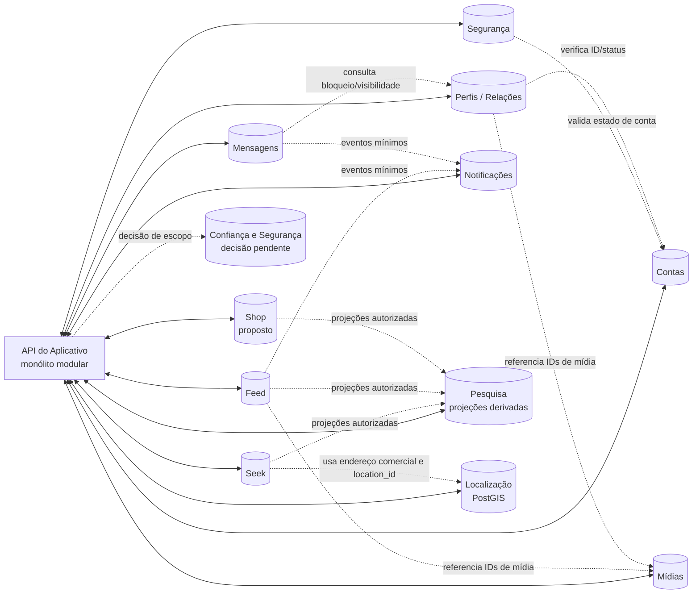

# Domínios de dados do Seekalive

**Status:** proposta de arquitetura para revisão; não implementada.  
**Atualizada:** 24/10/2026.  
**Ambiente observado:** desenvolvimento. Nenhum banco, conexão ou migration foi criado ou alterado por este documento.

## Objetivo e limites

Este documento propõe a propriedade dos dados antes de separar o PostgreSQL atual em bancos lógicos por domínio. O Aplicativo continua um monólito modular: bancos separados não implicam microserviços nem contas sociais duplicadas.

A referência anexada exige dez bancos lógicos: Contas, Segurança, Perfis/Relações, Mídias, Feed, Mensagens, Notificações, Pesquisa, Seek e Localização. O produto também tem Shop, mas a lista não define seu banco. Este documento propõe um banco próprio para Shop, sujeito à confirmação do usuário. Relatórios e moderação atravessam todos os módulos e também não têm domínio definido pela lista; ficam pendentes de decisão, sem alocação silenciosa.

Esta é uma proposta de ownership, não um schema pronto. O schema Drizzle atual — dez tabelas em um único banco de desenvolvimento — continua sendo a fonte de verdade do que está implementado. `docs/api/backend/schema-core.sql` continua uma proposta não aplicada e não pode ser executada como está.

## Regras de arquitetura propostas

1. **Uma identidade:** cada pessoa ou comércio tem uma única conta Social, com `account_id` UUID global, imutável e criado em Contas. A conta comercial que aparece no Seek continua sendo essa mesma identidade.
2. **Um domínio é dono da fonte oficial:** outros domínios usam contratos internos autorizados e guardam apenas IDs externos necessários; não consultam tabelas privadas de outro banco.
3. **Sem FKs entre bancos:** IDs de conta, mídia, localização, publicação e comércio podem aparecer como referências tipadas, mas a integridade/autorização é verificada pelo serviço dono. Não usar e-mail ou username como chave de relacionamento.
4. **Separação por responsabilidade:** senha/sessão não ficam em Contas; perfil público/comercial não vira uma extensão genérica de Contas; índices de busca e notificações não passam a ser fontes oficiais.
5. **Privacidade preservada:** idade permanece privada em Contas e nunca entra em DTO público; coordenada atual do usuário não é persistida por padrão. Endereço residencial de prestador não pode ser exposto como endereço comercial sem autorização explícita.
6. **Sem promessa de atomicidade distribuída:** cadastro, bloqueio, mídia, notificações e exclusão precisam de ordem, idempotência, falhas parciais e reconciliação documentadas antes da migração.
7. **Sem provedor escolhido:** nomes de variáveis abaixo são exemplos arquiteturais; não há segredos, conexão externa nem banco por domínio configurados.

## Matriz de domínio e propriedade

| Banco lógico proposto | Fonte oficial e dados que possui | Não deve possuir |
|---|---|---|
| **Contas** (`ACCOUNTS_DATABASE_URL`) | `account_id`; username normalizado e unicidade; e-mail normalizado e estado de verificação; tipo/status da conta; idade autodeclarada e termos aceitos, privados; estado básico de cadastro; respostas brutas e privadas de onboarding/interesses. A idade só é usada no servidor para a regra 18+. | Hashes de senha, sessões, tokens, histórico detalhado de segurança, conteúdo público completo ou dados de localização do aparelho. |
| **Segurança** (`SECURITY_DATABASE_URL`) | Hashes Argon2id; sessões e revogações; desafios de verificação/recuperação; MFA e códigos de recuperação se aprovados; tentativas/bloqueios de autenticação e eventos mínimos de segurança. Referencia a conta somente por UUID. | E-mail como chave de relacionamento, username como chave, conteúdo de perfil, posts ou mensagens. |
| **Perfis/Relações** (`PROFILES_DATABASE_URL`) | Projeção pública editável do perfil Social; nome de exibição, biografia, apresentação/local textual e preferências de visibilidade; avatar/capa por ID de mídia; follows, solicitações privadas, bloqueios e silenciamentos. Círculo é derivado de dois follows efetivos, sem tabela própria. Recomendação inicial: coleções/salvos pertencem aqui como relações tipadas privadas. | Senhas, tokens, sessão, e-mail privado, coordenada GPS atual ou uma segunda identidade para o comerciante. |
| **Mídias** (`MEDIA_DATABASE_URL`) | Metadados e ciclo de vida de fotos/vídeos/arquivos: proprietário, tipo validado, tamanho, dimensões/duração, estado de análise, variantes e referência ao armazenamento de objetos. Galeria de mídias por conta é consultada por este domínio. | Binários grandes no PostgreSQL, política de visibilidade duplicada ou autorização baseada apenas em URL/blob enviada pelo cliente. |
| **Feed/Publicações** (`FEED_DATABASE_URL`) | Publicações, artigos, comentários/respostas, curtidas, reposts, hashtags, menções e referências de conteúdo. A associação ordenada `post_media` pertence ao Feed e referencia IDs do domínio Mídias, sem FK entre bancos. | Credenciais, sessões, arquivos binários ou fonte oficial de perfil, comércio e mídia. |
| **Mensagens** (`MESSAGES_DATABASE_URL`) | Conversas, participantes, mensagens, solicitações, estado de envio/leitura e preferências próprias de mensagens, como quem pode enviar e recibos de leitura. | Senhas, cópia da tabela de bloqueios, corpos de mensagens em logs operacionais ou alegação de criptografia ponta a ponta não projetada. |
| **Notificações** (`NOTIFICATIONS_DATABASE_URL`) | Caixa de notificações, preferências de entrega, inscrições push e estado de entrega/leitura. Eventos de origem são referências tipadas e mínimas; o domínio não é fonte oficial do post, follow ou mensagem que gerou a notificação. | Credenciais, tokens de sessão, cópias integrais de mensagens ou FKs para entidades de outros bancos. |
| **Pesquisa/Indexação** (`SEARCH_DATABASE_URL`) | Documentos de índice derivados, versões/checkpoints de sincronização e estado de reconstrução. Pode começar com PostgreSQL se atender aos testes; outra tecnologia só se houver evidência de necessidade. | Fonte oficial de perfil, post, comércio ou produto; segredos, idade, e-mail ou localização precisa de usuário. Índices devem ser reconstruíveis e revalidar visibilidade/bloqueios. |
| **Seek** (`SEEK_DATABASE_URL`) | Listagens de comércios e prestadores vinculadas ao `account_id`; categorias comerciais/eventos; serviços realmente oferecidos, horários/exceções, áreas atendidas, avaliações/respostas, eventos e interesses em eventos. Usa `location_id` para o domínio Localização. | Login separado, credenciais, cópia da identidade da conta ou coordenadas duplicadas sem política de origem. Opção não oferecida/não informada continua fora do perfil público. |
| **Localização** (`LOCATION_DATABASE_URL`) | Catálogo geográfico oficial (incluindo municípios IBGE); localizações aprovadas de negócios/eventos e geometria PostGIS usada em busca por ponto/raio/região. Outros domínios recebem apenas operações internas e IDs. | Posição atual do usuário persistida por padrão, endereço público inferido ou provedor de mapa/geocodificação não aprovado. |
| **Shop** (`SHOP_DATABASE_URL`, recomendado; aguarda confirmação) | Catálogo de produtos/ofertas e dados próprios do vendedor comercial. `shop_items` pertence aqui. Operações futuras de estoque, carrinho, pedido, pagamento e entrega só entram com escopo e regras transacionais aprovados. | Segunda conta de vendedor, credenciais, endereço/coordenação copiados do Seek/Localização ou promessa de compra/pagamento que ainda não existe. |
| **Confiança e Segurança de Conteúdo** (domínio/banco ainda sem decisão) | Candidatos: denúncias e decisões de moderação sobre contas, posts, mensagens, avaliações, eventos e itens do Shop. A operação requer autorização restrita e referências tipadas, não FKs cruzadas. | Não será colocado automaticamente em Contas, Segurança de autenticação ou Painel. Sua inclusão como banco próprio precisa de decisão de escopo. |

### Diagrama conceitual

O desenho abaixo representa limites de propriedade e contratos do monólito, não uma implantação ativa. Setas significam chamadas internas autorizadas ou eventos mínimos; **não** significam acesso direto às tabelas nem FKs entre bancos.

### Dados operacionais transversais

- **Auditoria:** eventos de autenticação pertencem a Segurança; mudanças de conteúdo pertencem ao domínio que as executou. Um log central, se necessário, deve receber eventos mínimos e não virar cópia dos dados.
- **Exclusão/retificação/portabilidade:** Contas pode manter o pedido e o estado de coordenação; cada domínio continua responsável por excluir ou anonimizar seus próprios dados e confirmar conclusão. Backup não é apagado seletivamente por esta proposta.
- **Outbox e idempotência:** se um fluxo justificar entrega assíncrona, a outbox transacional fica no banco que grava a mudança; chaves de idempotência ficam junto à operação que as usa. Não criar uma outbox central por conveniência.
- **Webhooks:** recibos/deduplicação pertencem ao domínio que recebe e processa o webhook. Não há integração de pagamentos definida.
- **Categorias:** Seek mantém taxonomia de negócios/eventos; Shop mantém taxonomia de produtos. Localização é dona do catálogo de municípios. Não compartilhar uma tabela editável sem proprietário definido.
- **Salvos/coleções:** a recomendação é Perfis/Relações guardar a relação privada `(account_id, resource_type, resource_id)`. A leitura deve consultar o domínio de origem e reautorizar o recurso; item removido/privado não pode vazar metadados. Alternativa: cada domínio guardar seus próprios salvos, se o produto preferir.
- **Relatórios/moderação:** a lista de domínios anexada não define dono. A tabela atual proposta em `schema-core.sql` tem FKs para várias entidades; essas FKs não são válidas após a separação. A decisão entre um domínio restrito de Confiança e Segurança de Conteúdo ou outro escopo deve preceder qualquer schema.

## Mapeamento das tabelas atuais

| Tabela atual (um único banco) | Destino proposto | Observação de migração |
|---|---|---|
| `accounts` | **Dividir por campo** entre Contas, Perfis/Relações e Mensagens. | Não copiar a linha inteira para mais de um lugar. Contas conserva ID, username, tipo/status, idade/termos e onboarding; Perfis/Relações conserva dados públicos e visibilidade; Mensagens conserva preferências de mensagens/leitura. `is_verified` precisa ser definido como estado de e-mail ou selo público — não misturar os dois. |
| `account_emails` | Contas | `account_id` continua global; confirmação é atualizada por operação autorizada da API depois de validar o desafio em Segurança. |
| `password_credentials` | Segurança | Só hash Argon2id e versão da política; nenhuma senha em claro ou cópia em Contas. |
| `auth_challenges` | Segurança | Desafios de uso único, finalidade, tentativas, expiração e consumo. |
| `sessions` | Segurança | Sessão/csrf revogável, referenciando UUID da conta sem FK cruzada. |
| `business_profiles` | **Dividir**: perfil público básico em Perfis/Relações; listagem, endereço e operação comercial em Seek; município canônico e coordenadas/geometria em Localização. | A conta comercial não é criada de novo. O `account_id` e o `location_id` ligam os contextos por contrato. Seek é dono do endereço declarado; Localização é dona da representação geográfica validada. Antes do schema, confirmar se cada comerciante terá apenas um endereço ou várias unidades. |
| `account_interests` | Contas (recomendação) | Manter as respostas originais privadas. Algoritmos recebem somente projeção autorizada e necessária; definir consentimento, edição e exclusão antes de usar em ranking. |
| `account_follows` | Perfis/Relações | A relação é aceita; chave composta de UUIDs no mesmo banco. |
| `account_follow_requests` | Perfis/Relações | Pedido pendente não concede visibilidade; aprovação cria follow efetivo no mesmo domínio. |
| `account_blocks` | Perfis/Relações | Bloquear remove follows/pedidos em ambas as direções. Mensagens ficam ocultas enquanto o bloqueio existe e reaparecem após desbloqueio, sem duplicar ou apagar o histórico. |

### Separação por campo do `accounts` atual

| Campo atual | Fonte oficial proposta | Condição |
|---|---|---|
| `id` | Contas | UUID global estável, nunca e-mail/username. |
| `username`, `accountType`, `status` | Contas | Unicidade e estado do ciclo de vida centralizados; mudanças propagadas por contrato. |
| `age`, termos aceitos | Contas | Privados; idade não é devolvida nem mesmo em Configurações. |
| `firstName`, `lastName` | Contas inicialmente | Dados de cadastro privados, a menos que o usuário escolha publicá-los no perfil. |
| `displayName`, `bio`, `locationLabel`, `websiteUrl` | Perfis/Relações | Apenas a projeção pública aprovada; `locationLabel` é texto, não coordenada. |
| `isPrivate` | Perfis/Relações | A regra precisa ser consultada em cada leitura/interação relevante. |
| `messagesPolicy`, `readReceipts` | Mensagens | O domínio de Mensagens aplica a preferência e também consulta bloqueio/visibilidade em Perfis/Relações. |
| `onboardingCompletedAt`, `account_interests` | Contas | Estado/ respostas privadas; personalização não muda a política de privacidade do perfil. |
| `isVerified` | **Pendente de definição** | Distinguir confirmação de e-mail (Contas) de eventual verificação pública/comercial (processo de confiança/moderação). Não permitir selo editável pelo titular. |
| `version`, timestamps | Domínio dono de cada campo | Controle de concorrência local por domínio; evitar uma versão global alterada por gravações em bancos diferentes. |

## Entidades propostas em `schema-core.sql`

O arquivo propõe um modelo de 43 tabelas em um único SQL. Para esta arquitetura, as tabelas de conteúdo poderiam ser distribuídas assim, **sem aplicar o SQL atual**:

- **Contas:** `accounts`, `account_emails`; `account_interests` precisa ser acrescentada ou conciliada com o onboarding atual.
- **Segurança:** `password_credentials`, `auth_challenges`, `sessions`.
- **Perfis/Relações:** campos públicos de perfil que hoje estão em `accounts`, privacidade, `follows`, `blocks`, `mutes` e, conforme a decisão de produto, `saved_resources`.
- **Mídias:** `media_assets`; `post_media` permanece como relação no Feed. Avatar, capa, galeria, feed, Seek e Shop guardam apenas IDs de mídia.
- **Feed:** `posts`, `post_media`, `post_mentions`, `hashtags`, `post_hashtags`, `comments`, `comment_likes`, `post_likes`, `reposts`, `post_references`.
- **Seek:** `business_profiles` (dados da listagem, não a identidade), `business_hours`, `business_hour_exceptions`, `business_service_areas`, `business_reviews`, `seek_events`, `event_interests`.
- **Shop:** `shop_items`; separar o domínio exige adicionar seu banco ao escopo, ainda não especificado no prompt.
- **Mensagens:** `conversations`, `conversation_participants`, `messages`.
- **Notificações:** `notifications`, `push_subscriptions`.
- **Localização:** `cities` e novas tabelas geográficas com PostGIS; a proposta SQL atual não contém PostGIS nem coordenadas.
- **Pesquisa:** documentos e checkpoints derivados precisam de um schema futuro; a proposta não contém índice/search tables.
- **Ainda sem dono aprovado:** `reports`, `moderation_actions`, parte de `audit_logs`, `privacy_requests`, `outbox_events`, `idempotency_keys`, `webhook_receipts` e tabelas de `account_settings`. Devem ser distribuídos por finalidade ou receber domínio próprio. Não preservar suas FKs atuais quando cruzarem bancos.

## Fluxos entre domínios: fonte de verdade e consistência

| Fluxo | Donos e ordem proposta | Falha que precisa ser tratada |
|---|---|---|
| Cadastro/verificação | Contas cria `account_id` e estado pendente; Segurança cria credencial e desafio; após desafio válido, Contas marca e-mail verificado/conta ativa; Segurança emite sessão somente depois da confirmação do estado de Contas. | Não há transação entre bancos. Cada comando precisa ser idempotente; repetir não cria duas contas/desafios/sessões. Definir estado intermediário e compensação para cadastro parcialmente criado antes de implementar. |
| Login | Segurança compara Argon2id e gerencia limites; consulta autorizada a Contas confirma conta ativa e e-mail verificado; só então Segurança cria sessão. | Indisponibilidade de qualquer domínio falha fechado: não criar sessão com status desconhecido. |
| Perfil comercial no Seek | Contas prova que o UUID existe e é comercial; Perfis/Relações fornece a apresentação pública; Seek fornece categoria, serviços/horários, eventos e avaliações; Localização fornece a operação espacial quando habilitada. | Nenhuma identidade/estabelecimento duplicado. Mudança de tipo, suspensão e exclusão precisam invalidar/publicar projeções de forma idempotente. |
| Publicação com mídia/local | Feed valida a conta/autorização; Mídias valida proprietário, estado `ready` e finalidade; Localização valida ID/visibilidade se a publicação incluir local. Feed grava a publicação e relações locais. | Não afirmar publicação concluída se o recurso referenciado falhou. Usar processamento local/outbox somente se a operação exigir efeito assíncrono durável. |
| Bloqueio e mensagens | Perfis/Relações grava bloqueio e remove relações afetadas; Mensagens consulta a regra antes de enviar/ler e oculta histórico enquanto ativo. | Histórico não é apagado; após desbloqueio fica restaurável, conforme regra atual. Cache/índice não pode continuar exibindo conteúdo bloqueado. |
| Notificação e indexação | O domínio de origem é dono do fato; Notificações/Search recebem evento ou projeção mínima e reautorizam antes de exibir. | Duplicatas e eventos fora de ordem são esperados; definir idempotência, remoção e reconstrução antes de adicionar worker. |
| Exclusão/retificação de conta | Contas registra o pedido e coordena; Segurança revoga sessões; cada domínio elimina/anonimiza somente seus dados e confirma. | Estado parcial é visível e reconciliável; não chamar uma solicitação de exclusão “concluída” antes de obter confirmações e tratar backups/retentivas. |

## Decisões que ainda precisam do usuário

1. **Shop:** recomenda-se banco lógico próprio porque é um módulo separado e seu catálogo tem ciclo de vida distinto do Seek. Isso adiciona um domínio além dos dez listados no prompt; não inclui pedidos/pagamentos, que continuam fora do escopo.
2. **Denúncias e moderação:** recomenda-se avaliar um domínio restrito de Confiança e Segurança de Conteúdo, pois os alvos atravessam Feed, Mensagens, Seek e Shop. Isso adiciona escopo e possível banco; alternativa é adiar essas tabelas, sem fingir que pertencem a um dos domínios atuais.
3. **Nome público:** confirmar se nome/sobrenome informados no cadastro são privados por padrão e se só `displayName` aparece no perfil. A proposta mantém nome civil e idade em Contas, e nome público em Perfis/Relações.
4. **Unidades comerciais:** confirmar se um perfil comercial terá uma localização principal ou poderá manter várias unidades. O desenho recomendado mantém o endereço declarado no Seek e referencia a representação geográfica por `location_id`, sem coordenadas duplicadas.
5. **Salvos/coleções:** confirmar se Perfis/Relações pode ser fonte de salvos globais tipados, ou se cada módulo deve guardar seu próprio favorito.
6. **Selo verificado:** definir se `isVerified` significa e-mail confirmado ou selo público/comercial. A recomendação é armazenar esses estados separadamente e nunca deixar que o titular altere o selo.

## Ordem e critérios para adoção

- Esta matriz não muda a ordem de produto já estabelecida: concluir e validar a Social antes de avançar para Seek/Shop. O prompt sugere Location/PostGIS antes dos demais domínios; essa sequência conflita com o gate Social. A proposta é não provisionar nem implementar Location/Seek antes do gate Social sem nova decisão explícita.
- Primeiro resolver as decisões acima e os limites de consistência; em seguida comparar provedor externo que permita múltiplos bancos, roles independentes, PostgreSQL compatível e PostGIS, sem criar instância ainda.
- Só depois criar configuração por domínio, permissões mínimas e migrações versionadas. Não sobrescrever `DATABASE_URL`, não reutilizar uma credencial superusuária e manter o destino de pós-merge atual até validação e autorização próprias.
- Testar cada banco em isolamento: criação limpa, falha de conexão, autorização, operações parciais/idempotentes, exportação, backup, restauração e migração reversível. PostGIS requer testar SRID, validação, `geography(Point,4326)` ou alternativa justificada, GiST e plano de consulta.

**Conclusão:** esta matriz é o mapa recomendado para revisão. Ela resolve a primeira atribuição de dados, mas não aprova automaticamente o banco adicional de Shop, Trust & Safety, cardinalidade de unidades, política de salvos ou selo verificado. Até essas decisões serem respondidas, não há autorização para dividir ou migrar tabelas.
